# DocVerify AI – System Architecture Documentation

## 1. High-Level Executive Summary
**DocVerify AI** is an enterprise-grade, privacy-centric, and AI-assisted document verification platform. It allows applicants to submit documents for specific jurisdictional application types (e.g., passports, visas, licenses, certifications) and evaluates completeness, validity, consistency, and structural integrity.

The system is built upon four fundamental engineering tenets:
1. **Explainable AI & Human-in-the-Loop**: The platform never labels a document as "fraudulent" without human administrator review. Tamper indicators and mismatches are surfaced as detailed diagnostic flags.
2. **Deterministic Rules Over Hallucinations**: Critical decisions (e.g., expiry dates, checklist completeness, mandatory fields) use deterministic parsers and temporal algebra. If an expiry date cannot be identified with high confidence, the system returns `EXPIRY_DATE_NOT_FOUND` rather than hallucinating.
3. **Defense-in-Depth Security**: File uploads undergo MIME magic byte inspection, path sanitization, SHA-256 fingerprinting, and AES-256-GCM encryption at rest. Sensitive personal data (PII) is masked in logs.
4. **Configurable Requirements**: Requirement matrices are decoupled from business logic and parameterized by jurisdiction, service type, and validity thresholds.

---

## 2. End-to-End Architectural Diagram

```mermaid
flowchart TD
    subgraph ClientLayer["Frontend Presentation Layer (React 18 + Tailwind CSS)"]
        UI_AUTH["Auth & Registration\n(JWT Bearer)"]
        UI_APPLY["Application & Jurisdiction\nSelector"]
        UI_UPLOAD["Multi-File Drag-and-Drop\nUploader (PDF/JPG/PNG)"]
        UI_DASH["Interactive Verification Dashboard\n(Completeness, Expiry, Mismatches)"]
        UI_CORRECT["User OCR Correction\nInterface"]
        UI_ADMIN["Admin Review & Audit Portal"]
        UI_REPORT["Downloadable PDF\nVerification Report"]
    end

    subgraph APILayer["API Gateway & Application Layer (FastAPI)"]
        ROUTER_AUTH["/api/v1/auth\n(Login, Register, Refresh)"]
        ROUTER_APPS["/api/v1/applications\n(Checklists & Types)"]
        ROUTER_DOCS["/api/v1/documents\n(Secure Upload & Stream)"]
        ROUTER_VERIF["/api/v1/verify\n(Pipeline Coordinator)"]
        ROUTER_ADMIN["/api/v1/admin\n(Overrides & Audit)"]
        ROUTER_REPORTS["/api/v1/reports\n(PDF Generation)"]
    end

    subgraph ServiceLayer["Core Business & AI/ML Processing Engines"]
        SVC_STORAGE["Storage Service\n(AES-256 Encryption, SHA-256)"]
        SVC_OCR["OCR Engine Abstraction\n(PaddleOCR / Tesseract / PyMuPDF)"]
        SVC_NER["Field Extraction & Classifier\n(Names, Dates, ID Numbers, Categories)"]
        SVC_REQ["Requirement Checker Matrix\n(Mandatory, Optional, Completeness)"]
        SVC_EXP["Expiry Detection Engine\n(Temporal Window, Warning Thresholds)"]
        SVC_MISMATCH["Entity Mismatch Engine\n(Fuzzy String, Phonetics, DOB Matching)"]
        SVC_TAMPER["Forensic Tamper Detector\n(ELA Analysis, EXIF/Metadata Anomaly)"]
        SVC_PDF["PDF Report Engine\n(ReportLab / Structured Summary)"]
    end

    subgraph DataLayer["Persistence & Storage Layer"]
        DB[(SQLAlchemy ORM\nPostgreSQL / SQLite)]
        VAULT[(Encrypted Blob Storage\nAES-256 Encrypted Files)]
        CACHE[(Forensic ELA Visual Artifacts)]
    end

    UI_AUTH --> ROUTER_AUTH
    UI_APPLY --> ROUTER_APPS
    UI_UPLOAD --> ROUTER_DOCS
    UI_DASH --> ROUTER_VERIF
    UI_CORRECT --> ROUTER_DOCS
    UI_ADMIN --> ROUTER_ADMIN
    UI_REPORT --> ROUTER_REPORTS

    ROUTER_AUTH --> DB
    ROUTER_APPS --> DB
    ROUTER_DOCS --> SVC_STORAGE
    ROUTER_DOCS --> DB
    ROUTER_VERIF --> SVC_OCR
    ROUTER_VERIF --> SVC_NER
    ROUTER_VERIF --> SVC_REQ
    ROUTER_VERIF --> SVC_EXP
    ROUTER_VERIF --> SVC_MISMATCH
    ROUTER_VERIF --> SVC_TAMPER
    ROUTER_VERIF --> DB
    ROUTER_REPORTS --> SVC_PDF

    SVC_STORAGE --> VAULT
    SVC_TAMPER --> CACHE
    SVC_PDF --> DB
```

---

## 3. Core Functional Subsystems

### 3.1 Authentication & RBAC (Role-Based Access Control)
- **Password Security**: Argon2id or bcrypt hashing with high work factor.
- **Tokens**: Stateless JWT (JSON Web Tokens) with 15-minute access expiration and 7-day refresh tokens.
- **Roles**:
  - `applicant`: Can submit applications, upload documents, view own reports, and correct OCR extractions on their files.
  - `admin`: Can inspect all submissions, execute manual overrides, approve/reject reviews, and modify requirement checklists.
  - `auditor`: Read-only access to tamper analyses, mismatch logs, and compliance audit trails.

### 3.2 Secure Ingestion & Storage Pipeline
1. **Magic Byte Verification**: Uses header signatures (`%PDF-`, `\xFF\xD8\xFF`, `\x89PNG`) to prevent executable file masking.
2. **File Size & Content Sanitization**: Maximum limit enforced (e.g., 15MB/file), stripped of embedded scripts or malicious PDF action dictionaries.
3. **At-Rest Encryption**: Files written to disk are encrypted using AES-256-GCM. Filenames on disk are UUID-randomized with zero applicant PII in paths.
4. **Data Integrity**: SHA-256 checksum calculated on raw upload and stored to detect any storage tampering.

### 3.3 AI-Powered Document Recognition & OCR
- **Multi-Engine Pipeline**:
  - Direct Digital Extraction: PyMuPDF for native vector PDFs (100% character fidelity).
  - Raster OCR: PaddleOCR / Tesseract with preprocessing (grayscale, adaptive thresholding, deskewing).
- **Rule-Guided NER & Entity Extraction**:
  - Document Classification: Classifies document into Passport, National ID, Driver's License, Utility Bill, Bank Statement, Birth Certificate, Application Form.
  - Key Entity Extractor: Extracts Full Name, Date of Birth, Document/Certificate Number, Issue Date, Expiry Date, Address, and Issuing Authority.
  - Confidence Scoring: Each field receives an individual confidence score `[0.0 - 1.0]`. Low confidence extractions are flagged for human correction.
- **Applicant Correction Loop**: Applicants can review extracted values and submit corrections. Both raw OCR and user-corrected values are preserved for transparency.

### 3.4 Requirement Checker Matrix
- Decoupled from hardcoded rules using configurable requirements per application profile (e.g., `US_PASSPORT_RENEWAL`, `UK_WORK_VISA`, `GLOBAL_KYC`).
- Maps acceptable document categories to required checklist items (e.g., Proof of Address accepts Utility Bill, Bank Statement, or Council Tax letter).
- Outputs clear statuses: `COMPLETE`, `INCOMPLETE`, or `REVIEW_REQUIRED` along with an explicit list of satisfied and missing items and actionable next steps.

### 3.5 Temporal Expiry Detection Engine
- Standardizes multi-format dates (`YYYY-MM-DD`, `DD/MM/YYYY`, `MM/DD/YYYY`, `DD-Mon-YYYY`).
- Configurable warning horizon (default 30, 60, or 90 days before expiry).
- Categorization:
  - `VALID`: Expiry date > today + threshold.
  - `EXPIRING_SOON`: Expiry date between today and threshold.
  - `EXPIRED`: Expiry date < today.
  - `EXPIRY_DATE_NOT_FOUND`: Document has no discernible expiry date (e.g., Birth Certificates or unreadable scans).
  - `MANUAL_VERIFICATION_REQUIRED`: Ambiguous date formatting (e.g., `05/06/2026`).

### 3.6 Cross-Document Entity Mismatch Engine
- Compares identity attributes across all uploaded files in a single application bundle.
- **Name Matching**:
  - Exact match vs. Case-insensitive token intersection.
  - Permutation invariance (e.g., "Jane Marie Doe" vs "Doe, Jane Marie").
  - Levenshtein Distance & Jaro-Winkler metric (tolerating 1-2 character OCR noise while flagging substantive discrepancies).
  - Double Metaphone phonetic similarity.
- **DOB & ID Matching**: Strict date alignment; flags conflicting birth dates or differing document numbers.

### 3.7 Forensic Image Tampering & Anomaly Detection
- **Error Level Analysis (ELA)**: Re-compresses the image at an 90-95% JPEG quality level and measures pixel error magnitude. Areas modified or pasted digitally exhibit significantly different compression error variance compared to the original background.
- **Metadata Forensics**: Inspects EXIF/XMP headers and PDF metadata for digital authoring software traces (`Photoshop`, `GIMP`, `Canva`, `Sejda`, `ILovePDF`).
- **Explainability Standard**: The system never declares a document "fraudulent". It raises explainable flags (e.g., `[FLAG: ELA_INCONSISTENCY] Detected localized compression anomaly in certificate number region; flagged for manual review`).

### 3.8 Verification Report Generation
- Aggregates all analyses into an official verification report.
- Provides downloadable PDF format featuring verification summary, checklist fulfillment status, field comparison table, tamper diagnostic summary, and auditor sign-off box.
